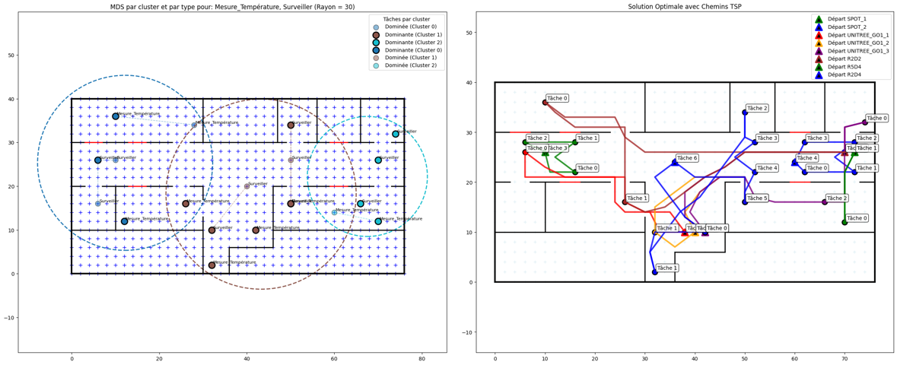

# Multi-Robot Path Planning & Task Allocation

Simulation of a fleet of heterogeneous robots operating in a building floor plan (Mines Nancy's TechLab): **A\* path planning** around walls and doors, **task allocation** using graph methods, and **route optimisation (TSP)** under distance, time and energy constraints.

Department project (*Projet ID*), Mines Nancy (2nd year, 2024–2025), by Guilherme Péres Tatagiba and Anass Abjilini. It continues the 2023–2024 work by A. Chemin and S. Maurin.



## Problem

A set of robots, each with different capabilities (camera, thermometer, arm, general-purpose), has to perform tasks spread across a building: surveillance, temperature measurement, opening and closing doors, and so on. The questions are:

- How should each robot move through the rooms without crossing walls?
- Which robot should take which task?
- In what order should the tasks be done, given each robot's distance, time and energy limits?

## Approach

| Step | Method |
|---|---|
| Environment | Floor plan modelled as a grid graph (NetworkX); walls and doors (open/closed) loaded from Excel |
| Path planning | **A\*** search for one robot, then several robots sharing the space |
| Task assignment | **Bipartite graph matching** (robots ↔ tasks) solved with **Ford-Fulkerson** max-flow |
| Task grouping | **Louvain** community detection (edge weights `exp(-d/σ)`, σ = 5) and **K-Means** to cluster nearby tasks |
| Redundancy reduction | **Minimum Dominating Set** per task type: one measurement can cover nearby points within a radius |
| Routing | **TSP** over each robot's assigned tasks, with multi-round planning |
| Constraints | Robot speed, maximum distance, working-time window and energy budget |
| Visualisation | Matplotlib plots and an animated Tkinter view |

Example result: the dominating set reduced *surveillance* tasks from 11 to 7 (−36%) and *temperature* tasks from 9 to 6 (−33%). All 22 remaining tasks were then assigned and routed across the fleet.

## Repository

```
notebooks/
  01_astar_single_robot.ipynb          A* for one robot in the floor plan
  02_astar_multi_robot.ipynb           generalisation to several robots
  03_bipartite_assignment.ipynb        robot-task matching (Ford-Fulkerson)
  04_tsp_only.ipynb                    TSP routing in isolation
  05_tsp_routing.ipynb                 assignment + TSP + dynamic Tkinter view
  06_energy_constraints.ipynb          energy-aware assignment and scheduling
  07_clustering_task_allocation.ipynb  Louvain / K-Means clustering, MDS, multi-round allocation (latest version)
data/        floor plan (walls, doors), robots and tasks (.xlsx)
sandbox/     small Tkinter experiments
```

## Running

```bash
pip install -r requirements.txt
cd notebooks && jupyter notebook
```

Code and comments are in French.

## Stack

Python · NetworkX · NumPy · pandas · Matplotlib · Tkinter · scikit-learn
